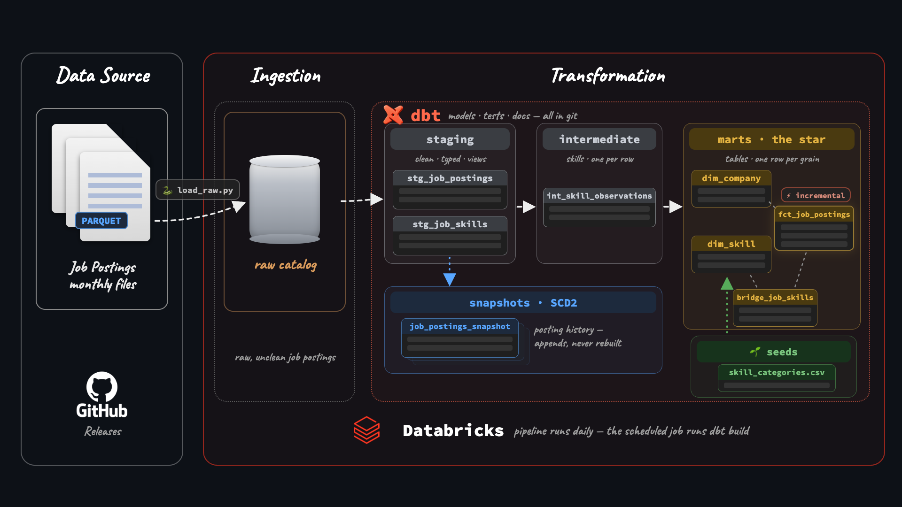
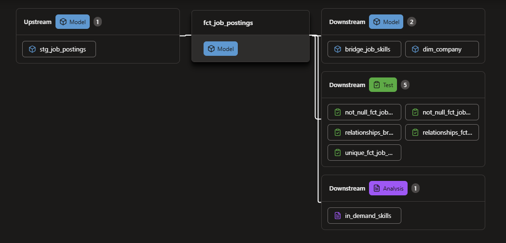

# Chapter 2: Using dbt + Databricks

A production dbt pipeline on **Databricks** over 800K raw job-posting scrapes, rebuild nightly be a scheduled job with zero secrets.

- Shapes medallion layers inot a tested star-schema = 491K jobs at a declared grain.
- Tracks a year of salary history with SCD2 snapsthos = 504K version rows.
- Loads incrementally and runs itself on a scheduled Databricks job - no tokens anywhere

> **v2 of this pipeline** - [v1](https://github.com/joemarbrillo/Learn-dbt-v2) built the foundations on DuckDB + GitHub Actions. `v2` moves the same dataset to a real warehouse: Databricks, SCD2 history, incremental loads, a scheduled job.

| What I Built | How I Implemented | Where to Look |
| --- | --- | --- |
| **Star Schema** | fact + dims + bridge on a declared grain | [`analytics/models/marts`](analytics/models/marts/) |
| **SCD2 snapshots** | a year of salary history backfilled | [`analytics/snapshots/`](analytics/snapshots/) + [`scripts/`](scripts/) |
| **Incremental facts** | merge on `job_id`, only new days load | [`fct_job_postings.sql`](analytics/models/marts/fct_job_postings.sql) |
| **Macros** | a custom parser + an overridden built-in | [`analytics/macros/`](analytics/macros/) |
| **Tests** | generic, singular, and custom generic | [`analytics/tests/`](analytics/tests/) |
| **Environments** | dev/prod as catalogs: dev from laptop, prod only from job | Unity Catalog: `dev` + `prod` |
| **Orchestration** | scheduled Databricks Job, zero secrets | Databricks -> Jobs * Pipelines |
| **Analyses** | questions, kept next to the models that answer them | [`analytics/analyses/`](analytics/analyses/) |

## The dbt Pipeline

And the dbt features doing the work:
| dbt Feature | How I Used It |
| --- | --- |
| Declared sources | `source('jobs', 'raw_job_postings')` - no hardcoded paths |
| Jinja beyond templating | benefits flags generated by a loop; one edit adds a flag |
| Custom macro | `parse_salary()` - one expression, written once, used four times |
| Installed package | `dbt_utils.get_column_values()` - the roles loop reads the data instead of a typed list |
| Overriding built-in | `generate_schema_name` - schemas land where the folder says |
| Seeds | the skill taxonomy: version-controlled reference data |
| Test-driven cleaning | `not_null` surfaced 6K+ real id-less postings; dropped with eyes open, documented |
| Singular + custom tests | `assert_salaries_sane` caught 27 types `...-1M` salary ceilings the schema tests never would |
|SCD2 snapshots | `check` strategy on 13 content columns; `searched_at` dates the version |
| Incremental | `dev` catalog from the local profile, `prod` catalog only from the scheduled job |

## Production

**Databricks** owns the runtime - storeage, compute, and the schedule, one platform:

- **Dev and prod as catalogs**: laptop builds land in the `dev` catalo; only the scheduled job writes the sames schemas inot `prod`
- **Scheduled Databricks Job** runs the whole pipeline nightly: `load_raw` (the ingesy notebook), then `dbt deps` -> `dbt debug` -> `dbt build`, pulling the repo straight from GitHub
- **Zero secrets**: the job generates a temporary-credentials profile against the attached warehouse and revokes it after the run - no tokens in the repo, no CI secrets.

## Snapshots

The marts keep each job's `latest` scrape - the snapshot table keeps **every version**, SCD2 over 13 watched columns:

- **504K+** version rows across **491K+** jobs - **10K+** jobs with real change history.
- **2K+** postings changed their salary between scrapes.

## Docs

Structure, tests, and column descriptions were written alond the way - the docs site is a rendeting of work already done:

See the models in action: [`Complete Analytics Docs`](https://joemarbrillo.github.io/Learn-dbt-Databricks/)

See **[Manuals](MANUAL.md)** for the step by step guide.